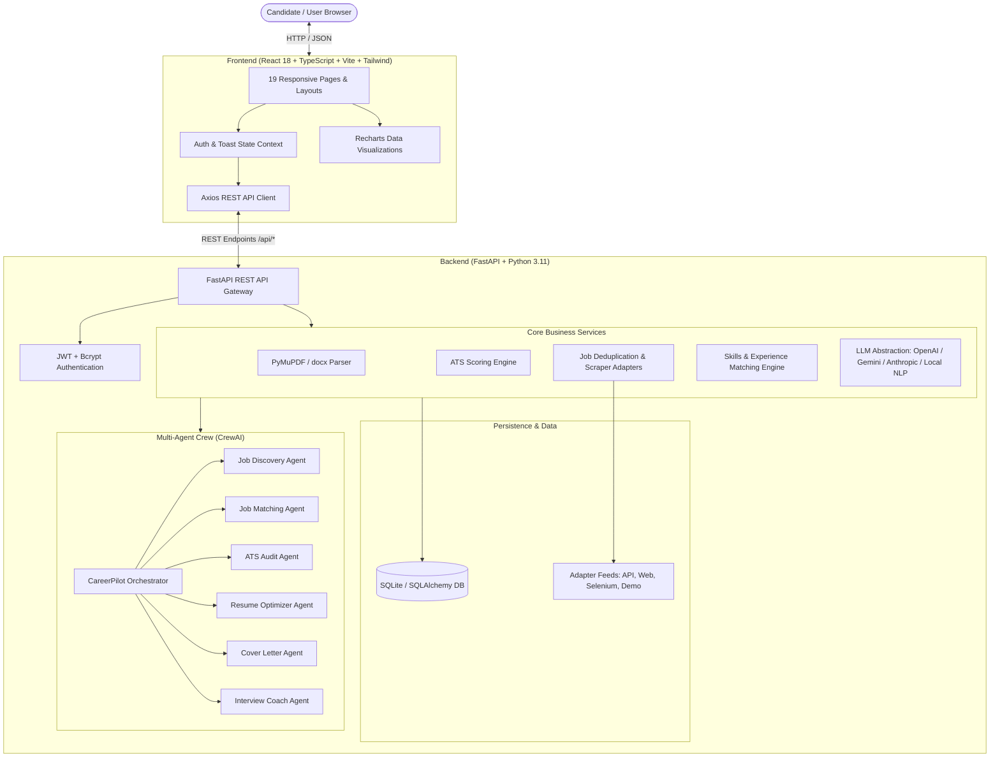

# CareerPilot AI 🚀
### Multi-Agent AI Job Search and Career Assistant Platform

[](https://www.python.org/downloads/)
[](https://fastapi.tiangolo.com/)
[](https://react.dev/)
[](https://crewai.com/)
[](LICENSE)

---

## 📖 Table of Contents
1. [Overview & Features](#-overview--features)
2. [System Architecture](#-system-architecture)
3. [How the Multi-Agent AI System Works (Student Guide)](#-how-the-multi-agent-ai-system-works-student-guide)
4. [Tech Stack](#-tech-stack)
5. [Prerequisites](#-prerequisites)
6. [Quick Start Guide](#-quick-start-guide)
7. [Manual Setup Guide](#-manual-setup-guide)
   - [Backend Setup (FastAPI)](#backend-setup-fastapi)
   - [Frontend Setup (React + Vite)](#frontend-setup-react--vite)
8. [Docker Deployment](#-docker-deployment)
9. [Running Automated Tests](#-running-automated-tests)
10. [Environment Variables Reference](#-environment-variables-reference)
11. [19 Interactive Application Pages](#-19-interactive-application-pages)
12. [Ethical AI & Anti-Hallucination Policy](#-ethical-ai--anti-hallucination-policy)

---

## 🌟 Overview & Features

**CareerPilot AI** is a complete, production-grade web application engineered to solve the fragmented, opaque, and tedious modern job application process. By combining a modern single-page React frontend, a high-throughput FastAPI backend, and a 6-agent collaborative AI crew powered by **CrewAI**, CareerPilot AI automates candidate workflows end-to-end:

* 📄 **Multi-Format Resume Ingestion**: Upload real PDF or DOCX resumes; extract candidate metadata, contact info, and structural bullet points using PyMuPDF and python-docx.
* 💯 **Deep ATS Audit Engine**: Weighted 0–100 score analyzing section structure, keyword density, quantified metrics, contact completeness, and bullet formatting.
* 🌐 **Multi-Source Job Aggregator**: Pluggable architecture supporting Live APIs, Web Scraping (BeautifulSoup), Browser Automation (Selenium), and a built-in curated 50+ role offline Demo Dataset.
* 🎯 **AI Job Match Score**: Multi-dimensional compatibility calculation (skills overlap, experience level, education, title alignment) with side-by-side gap breakdowns.
* ✍️ **Anti-Hallucination Resume Optimizer**: Transforms passive bullet points into high-impact STAR / Google X-Y-Z statements while strictly preserving candidate factual integrity.
* ✉️ **Tailored Cover Letter Generator**: Generates job-specific, tone-adjusted cover letters highlighting candidate experience mapped to company job requirements.
* 🎤 **Mock Interview Simulator**: Domain-specific question bank (Behavioral, Technical, System Design, Coding, etc.) with timed responses and immediate AI critique scoring structure, clarity, and relevance.
* 📋 **Kanban Application Pipeline**: Drag-and-drop / click-to-move Kanban board tracking applications from *Wishlist* through *Offer* and *Rejected*.
* 📊 **Market Intelligence & Telemetry**: Live interactive analytics charts (salary distributions, application velocity, match distributions, and high-demand skill trends).

---

## 🏛 System Architecture



---

## 🎓 How the Multi-Agent AI System Works (Student Guide)

### 1. What is an AI Agent?
A traditional software program executes strict, predetermined step-by-step instructions. An **AI Agent**, on the other hand, is an autonomous system that uses a Large Language Model (LLM) as its "brain" to perceive inputs, break down goals into sub-tasks, reason about solutions, and use specialized tools to complete objectives.

### 2. The 6 Specialized Agents in CareerPilot AI
Rather than asking a single general-purpose prompt to do everything (which causes hallucination, diluted focus, and low quality), CareerPilot AI employs **role specialization**:

1. **Job Discovery Agent**:
   - *Role*: Career Intelligence Researcher
   - *Goal*: Scours job sources, identifies newly published opportunities matching user parameters, and filters out spam or duplicate postings.
2. **Job Matching Agent**:
   - *Role*: Senior Talent Screener
   - *Goal*: Compares candidate profiles and parsed resumes against specific job descriptions to compute compatibility percentages and identify missing skills.
3. **ATS Audit Agent**:
   - *Role*: Automated Tracking System Specialist
   - *Goal*: Evaluates resumes against parsing rules, inspecting keyword frequency, quantifiable metrics, section headings, and contact information.
4. **Resume Optimization Agent**:
   - *Role*: Executive Career Coach & Technical Resume Writer
   - *Goal*: Rewrites bullet points using the **STAR** (Situation, Task, Action, Result) and **Google X-Y-Z** formulas (*"Accomplished [X] as measured by [Y], by doing [Z]"*).
5. **Cover Letter Agent**:
   - *Role*: Professional Communications Specialist
   - *Goal*: Crafts tailored, persuasive cover letters bridging the candidate's verified accomplishments with company values and required qualifications.
6. **Interview Preparation Agent**:
   - *Role*: Hiring Manager & Technical Interviewer
   - *Goal*: Conducts mock interview simulations, poses context-aware behavioral and technical questions, and scores candidate responses with constructive feedback.

### 3. CrewAI Orchestration & Collaboration
CareerPilot AI uses **CrewAI** to define each agent's `role`, `goal`, and `backstory`. The `CareerPilotOrchestrator` manages the workflow:
- **Sequential and Hierarchical Pipelines**: The output of one agent serves as the input to the next. For instance:
  `Resume Parser` ➔ `ATS Agent (Audit)` ➔ `Job Matching Agent (Match & Gap Analysis)` ➔ `Resume Optimizer (Targeted STAR Refinement)`.
- **Zero-Key Heuristic Fallback Engine**: If no OpenAI, Gemini, or Anthropic API keys are provided in `.env`, the system automatically activates its built-in rule-based NLP engine. This guarantees that students and developers can run every feature completely offline without recurring API costs.

---

## 💻 Tech Stack

| Domain | Technologies Used |
|---|---|
| **Frontend** | React 18, TypeScript, Vite, Tailwind CSS, Lucide React, Recharts, Axios |
| **Backend** | Python 3.11, FastAPI, Uvicorn, SQLAlchemy ORM, SQLite, Pydantic v2 |
| **AI / Multi-Agent** | CrewAI, LangChain, PyMuPDF (fitz), python-docx, Provider-Independent LLM Service |
| **Scraping / Adapters** | Requests, BeautifulSoup4, Selenium Driver abstraction, Curated Demo Dataset |
| **DevOps & QA** | Docker, Docker Compose, Nginx, Pytest, Pytest-Asyncio |

---

## 📋 Prerequisites

Before running the application locally, ensure you have:
* **Node.js**: v18.0.0 or later (Node 20+ or 22+ recommended)
* **Python**: v3.10 or v3.11 (Python 3.11 recommended)
* **Git**: latest version
* *(Optional)* **Docker & Docker Compose**: For containerized deployment

---

## ⚡ Quick Start Guide

### Option 1: Using the Automated Startup Scripts

**On Windows (PowerShell):**
```powershell
# In project root: careerpilot-ai/
# 1. Start Backend:
cd backend
python -m venv ..\.venv
..\.venv\Scripts\pip install -r requirements.txt
..\.venv\Scripts\uvicorn app.main:app --reload --port 8000

# 2. In a second terminal, start Frontend:
cd frontend
npm install
npm run dev
```

Visit:
- **Web Application**: `http://localhost:5173`
- **Interactive Swagger API Docs**: `http://localhost:8000/docs`
- **Backend Health Check**: `http://localhost:8000/api/health`

---

## 🛠 Manual Setup Guide

### Backend Setup (FastAPI)

1. Navigate to the backend directory:
   ```bash
   cd backend
   ```
2. Create and activate a Python virtual environment:
   ```bash
   # Windows
   python -m venv .venv
   .venv\Scripts\activate

   # macOS / Linux
   python3 -m venv .venv
   source .venv/bin/activate
   ```
3. Install dependencies:
   ```bash
   pip install -r requirements.txt
   ```
4. Copy environment configuration:
   ```bash
   cp .env.example .env
   ```
5. Run database migrations / initialization (automatic on launch):
   ```bash
   uvicorn app.main:app --reload --port 8000
   ```

### Frontend Setup (React + Vite)

1. Navigate to the frontend directory:
   ```bash
   cd frontend
   ```
2. Install npm packages:
   ```bash
   npm install
   ```
3. Copy environment configuration:
   ```bash
   cp .env.example .env
   ```
4. Launch the development server:
   ```bash
   npm run dev
   ```
5. Build for production:
   ```bash
   npm run build
   ```

---

## 🐳 Docker Deployment

To launch both the backend API and frontend Nginx container with a single command:

```bash
docker-compose up --build
```

Access:
* **Frontend**: `http://localhost:3000`
* **Backend API**: `http://localhost:8000/docs`

---

## 🧪 Running Automated Tests

CareerPilot AI includes a comprehensive Pytest test suite covering authentication, parsing, job scraping, ATS scoring, application Kanban transitions, interview evaluations, and the **full 21-step end-to-end user workflow**:

```bash
# In the backend directory (with virtual environment activated):
pytest -v
```

Expected Output:
```
backend/tests/test_applications.py::test_application_kanban_flow PASSED
backend/tests/test_auth.py::test_register_and_login PASSED
backend/tests/test_full_workflow.py::test_full_21_step_end_to_end_workflow PASSED
backend/tests/test_interviews.py::test_interview_preparation_and_evaluation PASSED
backend/tests/test_jobs.py::test_jobs_api_and_search PASSED
backend/tests/test_resumes.py::test_resume_upload_and_ats_analysis PASSED

======================= 6 passed in 11.21s =======================
```

---

## ⚙️ Environment Variables Reference

| Variable | Default Value | Description |
|---|---|---|
| `DATABASE_URL` | `sqlite:///./careerpilot.db` | SQLAlchemy connection string |
| `SECRET_KEY` | `careerpilot-secret-key-change-in-prod` | JWT signing secret |
| `ACCESS_TOKEN_EXPIRE_MINUTES` | `1440` | JWT lifespan (1 day) |
| `LLM_PROVIDER` | `heuristic` | LLM selector (`heuristic`, `openai`, `gemini`, `anthropic`) |
| `OPENAI_API_KEY` | *(empty)* | Optional OpenAI API Key |
| `GEMINI_API_KEY` | *(empty)* | Optional Google Gemini API Key |
| `ANTHROPIC_API_KEY` | *(empty)* | Optional Anthropic Claude API Key |
| `DEMO_MODE` | `true` | When true, includes verified demo roles & profiles |
| `CORS_ORIGINS` | `http://localhost:5173,http://localhost:3000` | Allowed web origins |

---

## 🖥 19 Interactive Application Pages

| # | Page | Route | Description |
|---|---|---|---|
| 1 | **Landing Page** | `/` | Hero section, value proposition, 6-agent cards, workflow steps |
| 2 | **Login Page** | `/login` | Secure JWT authentication with 1-click sample credential autofill |
| 3 | **Registration Page** | `/register` | Account creation with form validation |
| 4 | **Candidate Dashboard** | `/dashboard` | 6 telemetry cards, Recharts status charts, active recommendations |
| 5 | **Candidate Profile** | `/profile` | Experience level, target roles, interactive skills tag manager |
| 6 | **Resume Manager** | `/resumes` | Resume library, primary selector, quick-action audit buttons |
| 7 | **Resume Upload** | `/resumes/upload` | Drag-and-drop PDF/DOCX parser with verified 1-click sample loader |
| 8 | **ATS Audit & Scoring** | `/ats-analysis` | 0–100 gauge score, sub-metrics, formatting audit, keyword density |
| 9 | **Job Search & Discovery** | `/jobs` | Live filters, source adapter selector, search query, save actions |
| 10 | **Job Details** | `/jobs/:id` | Full description, company info, match calculator, quick shortcuts |
| 11 | **Recommended Jobs** | `/jobs/recommended` | Personalized feed ranked by candidate profile compatibility |
| 12 | **Job Match Analysis** | `/jobs/:id/match` | Side-by-side matching vs missing skills, education & experience check |
| 13 | **Resume Optimization** | `/resumes/optimize` | Before/After STAR bullet comparison, copyable Google X-Y-Z bullets |
| 14 | **Cover Letter Generator** | `/cover-letter` | Tone selector, custom instructions, live draft editor, TXT download |
| 15 | **Interview Preparation** | `/interview-prep` | Categorized question bank across 6 domains with practice launcher |
| 16 | **Mock Interview Simulator** | `/interview-simulator` | Interactive simulator with timer, response submission, and AI evaluation |
| 17 | **Application Tracker** | `/applications` | 6-column Kanban pipeline with status movement and stage notes |
| 18 | **Settings & Integrations** | `/settings` | LLM provider selector, live API health ping, demo mode toggle |
| 19 | **Career Insights & Market Trends** | `/insights` | Live market telemetry, top demand skills, salary ranges, legal notes |

---

## 🛡 Ethical AI & Anti-Hallucination Policy

CareerPilot AI is explicitly engineered around the **Principle of Factual Candidate Integrity**:
1. **Never Invent Experience**: The optimization and cover letter engines are constrained never to invent credentials, previous employers, projects, or certifications that do not exist in the candidate's base resume.
2. **Measurable Formulation**: Instead of fabricating numbers, the system isolates existing accomplishments and guides the user to frame them using the **Google X-Y-Z** format (`Accomplished [X], as measured by [Y], by doing [Z]`).
3. **Transparent Audits**: Missing skills are flagged as *growth opportunities* to pursue rather than falsely added to the candidate's resume.

---

## 📄 License
This project is licensed under the MIT License — see the [LICENSE](LICENSE) file for details.
